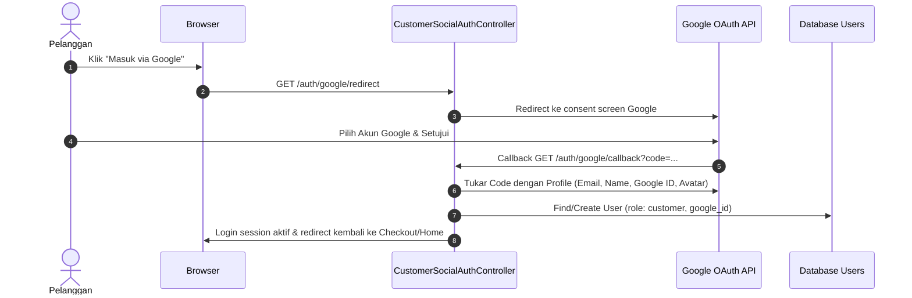
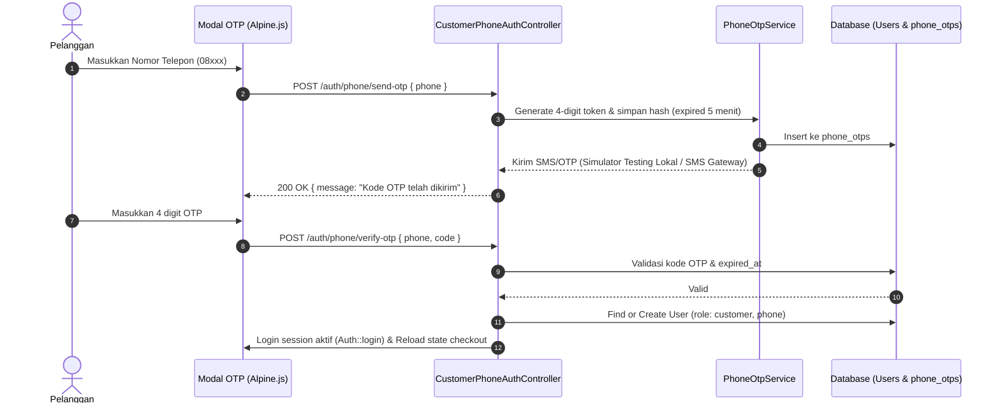

# Blueprint & Spesifikasi Teknis: Customer Membership & 3 Metode Login ("Kukis VIP Club")

Dokumen ini mendefinisikan arsitektur rekayasa perangkat lunak, spesifikasi database, alur otentikasi 3 metode (**Google Auth**, **Email & Password Manual**, dan **Nomor Telepon OTP**), serta integrasi promo member untuk repositori **NgemilKukis**. Seluruh implementasi wajib mematuhi [CODING_STANDARDS.md](file:///d:/laragon/www/NgemilKukis/CODING_STANDARDS.md).

---

## 1. Latar Belakang & Sasaran Bisnis

### 1.1. Problem Statement
* Saat ini toko hanya menyediakan *Guest Checkout*.
* Pelanggan setia yang sering membeli (*repeat order*) harus mengetik ulang nama, nomor telepon, dan alamat setiap bertransaksi.
* Toko belum memiliki database pelanggan terdaftar untuk program retensi, loyalitas, atau apresiasi member setia.

### 1.2. Solusi Utama
* Menghadirkan **Kukis VIP Club** dengan 3 opsi masuk yang fleksibel:
  1. **Google Auth (1-Click Login):** Paling cepat dan instan untuk pengguna Android, iPhone, dan laptop.
  2. **Email & Password (Daftar Manual):** Registrasi mandiri klasik di aplikasi bagi pelanggan yang menyukai akun berbasis email & kata sandi.
  3. **Nomor Telepon (Phone OTP):** Masuk cepat hanya dengan nomor ponsel tanpa perlu mengingat kata sandi.
* **Tetap Mempertahankan Guest Checkout:** Pengunjung baru yang ingin langsung bayar cepat tanpa mendaftar tetap difasilitasi penuh.

---

## 2. Nilai Tambah & Insentif Member (Member Perks)

| Fitur / Benefit | Deskripsi untuk Pelanggan | Dampak Bisnis |
| :--- | :--- | :--- |
| **Diskon Member Instan** | Potongan harga otomatis **Rp 10.000** pada pesanan saat berstatus member login. | Meningkatkan persentase pengunjung yang mendaftar menjadi member. |
| **1-Click Fast Checkout** | Formulir checkout (nama, nomor HP, alamat lengkap, kota) otomatis terisi dari profil akun. | Menurunkan angka pembatalan belanja (*cart abandonment rate*). |
| **Buku Alamat Pengiriman** | Dapat menyimpan alamat berbeda (Rumah, Kantor, Alamat Hampers Teman/Keluarga). | Mempermudah repeat order dan pengiriman kado. |
| **Riwayat Pesanan Privat** | Halaman `/pesanan` otomatis menyajikan semua pesanan aktif & riwayat kiriman milik member tanpa input manual. | Privasi data pelanggan terjaga aman tanpa bisa diintip orang lain. |

---

## 3. Strategi Konversi di Halaman Checkout (Psychological Hook)

Pelanggan tidak dipaksa mendaftar sebelum memilih kukis. Saat berada di halaman checkout sebagai tamu (*Guest*), sistem menampilkan banner ajakan ramah:

```text
+-----------------------------------------------------------------------------------------+
| 🎁 Mau Hemat Rp 10.000 untuk Pesanan Ini?                                                |
| Masuk dalam 10 detik & dapatkan potongan harga member otomatis!                         |
|                                                                                         |
|  [ G Masuk via Google ]    [ ✉️ Masuk via Email ]    [ 📱 Masuk via No. Telepon ]        |
|                                                                                         |
|  Atau: [ Tetap Lanjutkan Beli Sebagai Tamu → ]                                          |
+-----------------------------------------------------------------------------------------+
```

Jika pelanggan menekan salah satu tombol masuk:
1. Keranjang belanja di browser **tetap aman dan tidak reset**.
2. Setelah login berhasil, halaman checkout otomatis mendeteksi status member, menerapkan diskon Rp 10.000 ke total pembayaran, dan mengisi alamat otomatis.

---

## 4. Alur Kerja Otentikasi (3 Authentication Flows)

### 4.1. Alur 1: Google Authentication (OAuth 2.0)


### 4.2. Alur 2: Email & Password (Daftar Manual Langsung Aktif — Opsi 1 Pilihan)
* **Pendaftaran Mandiri Cepat (Instant Onboarding — Tanpa Jeda OTP):**
  * Formulir: Nama Lengkap, Alamat Email, Nomor HP, Password, dan Konfirmasi Password.
  * Validasi: Email unik, format telepon valid, password minimal 8 karakter.
  * Akun **langsung aktif seketika** tanpa menahan pembeli dengan OTP email (Zero Friction).
  * Session login langsung dimulai (`Auth::login($user)`), pelanggan langsung diarahkan kembali ke checkout dengan data auto-fill dan diskon Rp 10.000 terpasang otomatis.
* **Login Manual:**
  * Input Email & Password dengan proteksi *Rate Limiting* (maksimal 5 percobaan salah per menit).
  * Opsi *"Ingat Saya"* (Remember Me cookie 30 hari).

### 4.3. Alur 3: Nomor Telepon (Phone OTP)


---

## 5. Rencana Perubahan Skema Database

### 5.1. Update Tabel `users`
Menambahkan kolom otentikasi multi-channel dan profil belanja pelanggan:
```php
Schema::table('users', function (Blueprint $table) {
    // Multi-Channel Auth Identifiers
    $table->string('phone')->nullable()->unique()->after('email');
    $table->string('google_id')->nullable()->unique()->after('phone');
    $table->string('avatar_url')->nullable()->after('google_id');
    $table->string('auth_provider')->default('email')->after('avatar_url'); // email, google, phone

    // Customer Shopping Profile & Auto-fill
    $table->text('saved_address')->nullable()->after('auth_provider');
    $table->string('saved_city')->nullable()->after('saved_address');
    $table->unsignedInteger('member_discount_amount')->default(10000)->after('saved_city');
    $table->timestamp('phone_verified_at')->nullable()->after('email_verified_at');
});
```

### 5.2. Tabel Baru: `phone_otps`
Menyimpan token verifikasi nomor telepon sementara:
```php
Schema::create('phone_otps', function (Blueprint $table) {
    $table->id();
    $table->string('phone')->index();
    $table->string('otp_hash');
    $table->unsignedSmallInteger('attempts')->default(0);
    $table->timestamp('expires_at');
    $table->timestamp('verified_at')->nullable();
    $table->timestamps();
});
```

### 5.3. Tabel Baru: `customer_addresses` (Buku Alamat)
Menampung multi-alamat pelanggan untuk keperluan kirim kado / kantor:
```php
Schema::create('customer_addresses', function (Blueprint $table) {
    $table->id();
    $table->foreignId('user_id')->constrained('users')->cascadeOnDelete();
    $table->string('label')->default('Rumah'); // Rumah, Kantor, Kado Teman
    $table->string('recipient_name');
    $table->string('recipient_phone');
    $table->text('full_address');
    $table->string('city');
    $table->boolean('is_primary')->default(false);
    $table->timestamps();
});
```

---

## 6. Arsitektur Kode (Sesuai `CODING_STANDARDS.md`)

### 6.1. Controllers Terisolasi (Single Responsibility)
* `App\Http\Controllers\Auth\CustomerEmailAuthController`:
  * `showLoginForm(): View`
  * `login(CustomerLoginRequest $request): RedirectResponse`
  * `showRegisterForm(): View`
  * `register(CustomerRegisterRequest $request): RedirectResponse`
  * `logout(): RedirectResponse`
* `App\Http\Controllers\Auth\CustomerGoogleAuthController`:
  * `redirect(): RedirectResponse`
  * `callback(): RedirectResponse`
* `App\Http\Controllers\Auth\CustomerPhoneAuthController`:
  * `sendOtp(SendPhoneOtpRequest $request): JsonResponse`
  * `verifyOtp(VerifyPhoneOtpRequest $request): JsonResponse`
* `App\Http\Controllers\Customer\AccountController`:
  * `index(): View`
  * `updateProfile(UpdateCustomerProfileRequest $request): RedirectResponse`
* `App\Http\Controllers\Customer\AddressController`:
  * Resource CRUD untuk buku alamat pengiriman.

### 6.2. Dedicated Form Requests
* `CustomerRegisterRequest`: Validasi nama, email unik, telepon, password (min:8, confirmed).
* `CustomerLoginRequest`: Validasi email dan password.
* `SendPhoneOtpRequest`: Validasi format nomor telepon Indonesia (`08...` atau `628...`, min 10 digit).
* `VerifyPhoneOtpRequest`: Validasi nomor telepon dan 4-digit token OTP.
* `UpdateCustomerProfileRequest`: Validasi nama, email, telepon, alamat utama, dan kota.

### 6.3. Service Layer
* `App\Services\PhoneOtpService`:
  * Menangani pembuatan kode acak 4-digit, enkripsi hash, pengecekan brute-force, dan kedaluwarsa 5 menit.
  * Dilengkapi **Simulator / Local Log Driver** (untuk pengujian instan tanpa biaya pulsa SMS) dan **SMS Gateway Driver** untuk server live.
* `App\Services\CustomerDiscountService`:
  * Menghitung kelayakan diskon member saat pembuatan pesanan di `OrderService` (Zero Trust Client Input).

---

## 7. Desain Antarmuka (Standar 60-30-10 & Plus Jakarta Sans)

* **Palet Warna:**
  * 60% Putih Bersih (`#FFFFFF`) pada modal login, form register, dan kartu profil.
  * 30% Coklat Agak Tua (`#2D180C`) pada tipografi judul dan teks instruksi.
  * 10% Aksen Coklat Muda Karamel (`#B87D4B`) pada tombol utama, badge member, dan tombol submit.
* **Modal Dialog Masuk / Daftar:**
  * Tab 1: **Google (1-Click Login)** — Tombol putih bersih berlogo Google.
  * Tab 2: **Email & Password** — Form simpel email + password dengan opsi link *"Belum punya akun? Daftar gratis"*.
  * Tab 3: **Nomor Telepon** — Input nomor telepon dengan verifikasi 4-digit OTP interaktif.

---

## 8. Konfigurasi Environment (`.env`)

```env
# Google OAuth Configuration
GOOGLE_CLIENT_ID=your-google-client-id.apps.googleusercontent.com
GOOGLE_CLIENT_SECRET=your-google-client-secret
GOOGLE_REDIRECT_URI="${APP_URL}/auth/google/callback"

# Phone OTP Simulation & Gateway
PHONE_OTP_SIMULATION_MODE=true # true saat local testing, false saat live SMS gateway
PHONE_OTP_GATEWAY_URL=
PHONE_OTP_GATEWAY_TOKEN=
```

---

## 9. Standar Keamanan & Pengujian

1. **Anti-Spam OTP:** Middleware `throttle:3,1` (maksimal 3 request per menit per nomor IP/telepon).
2. **Brute Force Protection:** Token OTP hangus setelah 3 kali salah memasukkan kode.
3. **Validasi Server-Side Total Belanja:** Nilai diskon member selalu dihitung ulang di server (`OrderService`), bukan dari klien browser.
4. **Isolasi Database Testing:** Unit & Feature Tests menggunakan `RefreshDatabase` dengan 100% tes lulus.
5. **Laravel Pint Formatter:** Menjalankan `vendor/bin/pint --format agent` sebelum commit kode.

---

## 10. Tahapan Pengerjaan Bertahap (Implementation Roadmap)

1. **Fase 1: Database Migration & Model Foundation**
   * Migration kolom baru tabel `users` (`phone`, `google_id`, `avatar_url`, `saved_address`, `saved_city`).
   * Migration tabel `phone_otps` dan `customer_addresses`.
2. **Fase 2: Service & Backend Autentikasi**
   * Controller `CustomerEmailAuthController` (Register, Login, Logout manual).
   * Controller `CustomerGoogleAuthController` (Google OAuth flow).
   * Controller `CustomerPhoneAuthController` & `PhoneOtpService` (Phone OTP flow & simulator).
3. **Fase 3: Antarmuka UI (Modal Login 3 Tab & Navigasi)**
   * Desain modal pop-up login 3 tab (Google, Email, No Telepon) di navbar dan halaman checkout.
   * Halaman Akun Pelanggan `/akun` (kelola profil, alamat tersimpan, riwayat order).
4. **Fase 4: Integrasi Diskon Member & Auto-Fill Checkout**
   * Auto-fill otomatis data checkout saat pelanggan login.
   * Diskon otomatis Rp 10.000 untuk member aktif di `OrderService`.
5. **Fase 5: Validasi, Testing, & Pint Formatting**
   * PHPUnit Feature Tests untuk Register Email, Login Google, Phone OTP, dan diskon pesanan member.
   * Validasi browser tampilan responsif.
